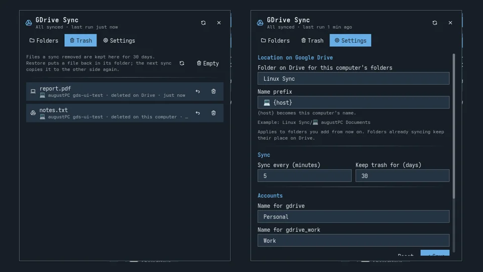

# GDrive Sync

Two-way sync between folders on your computer and Google Drive, in the spirit
of Google's Drive for desktop (which has no Linux version). It is a panel and a
bar icon around [rclone bisync](https://rclone.org/bisync/), plus Dolphin
right-click menus.

- **Sync a local folder:** it appears on Drive as
  `Linux Sync/💻 <computer> <folder>`, so you can tell where it came from
  without looking at its parent.
- **Keep a Drive folder offline:** a copy lands in `~/Drive Offline/<account>/`
  and syncs both ways.
- **Several accounts:** each Google Drive remote in rclone is an account
  (for example Personal and Work).
- **Sync trash:** a file a sync deletes is moved to a trash instead, on the
  side it was deleted from, and can be restored from the panel.



## Plugin

| Field | Value |
| --- | --- |
| ID | `augussst/gdrive-sync` |
| Entries | Panel: `panel`; bar widget: `status` |

## Requirements

| Program | Arch package | Needed for |
| --- | --- | --- |
| `rclone` | `rclone` | the sync itself |
| `jq` | `jq` | reading the JSON settings |
| `flock`, `systemctl` | `util-linux`, `systemd` | the timer, one sync at a time |
| `python3` | `python` | reading Dolphin's `rclone:/` addresses |
| `notify-send` | `libnotify` | notifications |
| `zenity` | `zenity` | the folder picker (optional) |
| `kwriteconfig6`, `dolphin` | `kconfig`, `dolphin` | folder icons and right-click menus (optional) |
| kio-rclone | `kio-rclone` (AUR) | browsing Drive in Dolphin, **Keep offline** menu (optional) |

The panel's **Setup** page checks all of these and shows the `pacman` command
for anything missing.

You also need at least one Google Drive remote in rclone. The Setup page has a
button that opens `rclone config` in a terminal: choose `n` (new remote), name
it (for example `gdrive`), pick `drive`, and sign in in the browser.

## Setup

1. Enable the plugin and add the **GDrive Sync** widget to your bar.
2. Open the panel. The Setup page shows until everything is in place.
3. Press **Install**. It copies `bin/gdrive-sync` to `~/.local/bin`, adds the
   Dolphin menus and starts a systemd user timer.

When the plugin is updated, the panel updates the installed copy by itself the
next time it opens.

## Usage

### Folders tab

- **Add folder…:** pick the account, then a folder. The first sync merges both
  sides and never deletes.
- **Keep offline:** type a folder path on Drive (for example
  `Documents/Work`), or press the Drive button to browse it in Dolphin.
- Each folder shows its account, its place on Drive and its last sync. The
  buttons sync it now, open it locally, open it on Drive (in Dolphin), and stop
  syncing it. Stopping leaves the files on both sides.

### Dolphin

- Right-click a local folder → **Google Drive Sync** → **Sync with Google
  Drive (account)**, or **Stop syncing this folder**.
- Right-click a folder under `rclone:/` → **Keep offline on this computer**.

Synced folders get a Google Drive folder icon (a `.directory` file in the
folder; it syncs too).

### Trash tab

Files a sync removed, newest first, with where they were deleted. **Restore**
puts the file back in its folder (as `name (restored).ext` if the name is
taken) and syncs it. Items older than the **Keep trash for** setting are
deleted once a day.

### Settings tab

| Setting | Default | Notes |
| --- | --- | --- |
| Folder on Drive | `Linux Sync` | Where local folders go. |
| Name prefix | `💻 {host} ` | `{host}` is the computer's name. |
| Sync every | 5 minutes | Rewrites the systemd timer. |
| Keep trash for | 30 days | |
| Account names | `gdrive` → Personal, `gdrive_work` → Work | Other remotes show their rclone name. |

Folder and prefix changes apply to folders added afterwards: each folder keeps
the Drive path it was created with.

**Resync all** rebuilds the sync state (it merges both sides and never
deletes). **Uninstall** removes the timer, the menus and the CLI, and keeps
your settings, folder list and files.

### Command line

Everything the panel does is a `gdrive-sync` command:

```sh
gdrive-sync add gdrive ~/Documents/Taxes
gdrive-sync offline gdrive:Documents/Work
gdrive-sync run                # sync everything now
gdrive-sync list
gdrive-sync trash list
gdrive-sync config set interval_min 10
```

`gdrive-sync` with no arguments lists all commands.

## How it syncs

- `rclone bisync` runs for every folder on a timer (default every 5 minutes),
  and once right after a folder is added. It is not instant.
- When a file changed on both sides, the newer one wins
  (`--conflict-resolve newer`).
- Deletions spread to the other side, but into the trash, never straight away:
  `--backup-dir1` keeps local ones in `~/.local/share/gdrive-sync/trash/`,
  `--backup-dir2` keeps Drive ones in `<Folder on Drive>/.trash/`. Each file
  gets a time stamp before its extension.
- bisync stops on its own if more than half the files of a folder would be
  deleted at once.
- If the sync state is gone (new computer, `~/.cache` cleared), the next sync
  resyncs, which merges and never deletes.

## Limits

- **Google Docs, Sheets and Slides** are not real files. rclone exports them as
  `.docx`, `.xlsx` and `.pptx`; edits to those copies do not go back as Google
  Docs.
- One local folder syncs with one account. Synced folders cannot be nested
  inside each other, and two folders cannot end up at the same Drive path.
- `~`, `/` and `~/GDrive*` (rclone mounts) cannot be added.
- Not real time: changes wait for the next timer run, or **Sync now**.
- Tested on one machine (CachyOS, niri, Noctalia 5.4.1, rclone 1.76).

## What it reads, writes and runs

| Path | What |
| --- | --- |
| `~/.config/gdrive-sync/config.json` | settings |
| `~/.config/gdrive-sync/folders.json` | the synced folders |
| `~/.cache/gdrive-sync/status.json` | last sync result per folder |
| `~/.local/share/gdrive-sync/trash/` | local sync trash |
| `~/.local/bin/gdrive-sync` | the CLI (installed copy of `bin/gdrive-sync`) |
| `~/.config/systemd/user/gdrive-sync.{service,timer}` | the timer |
| `~/.local/share/kio/servicemenus/gdrive-sync*.desktop` | Dolphin menus |
| `<folder>/.directory` | folder icon |

It runs `rclone`, `systemctl --user`, `zenity`, `xdg-open` and `dolphin`. Your
rclone login (`~/.config/rclone/rclone.conf`) is only used by rclone.
